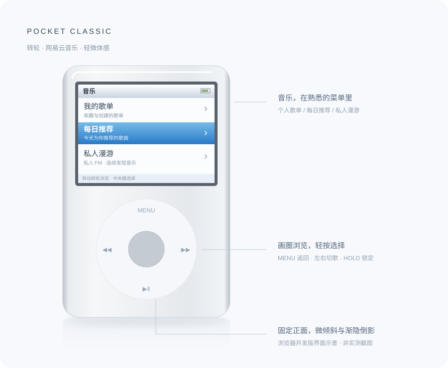
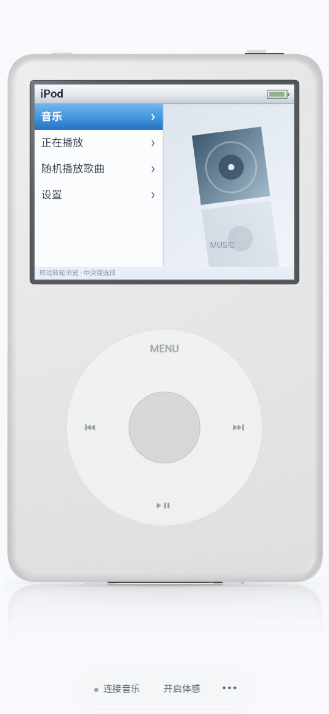

# Pocket Classic

**把熟悉的转轮和网易云音乐，放进一个口袋播放器。**

Pocket Classic 是一个以 iPod Classic 为灵感的音乐播放器项目。它用可操作的转轮、正面三维机身、细微的金属反光和低灵敏度体感，重现拿着播放器听歌的体验；安卓手机直接连接已授权的网易云账号。

<p align="center">
  
</p>

> 当前为 **Android 0.3.0 独立测试版**。登录、歌单、日推、漫游及播放地址解析均由手机直连网易云；无需电脑、局域网服务或配对码。界面资源随安装包提供，音乐通过 Media3 原生后台服务播放，登录状态使用 Android Keystore 加密保存在手机。实际手机手感与兼容性尚待真机验证。

## 安卓独立使用

<p align="center"></p>

1. 下载并安装 [Android 0.3.0 测试版](https://github.com/Lsyn-18/Pocket-Classic/releases/tag/v0.3.0)。
2. 点击底部「连接音乐」，再点击「保存并打开网易云」。
3. 在网易云「扫一扫 → 相册」选择刚保存的二维码，确认授权后返回播放器。
4. 进入「音乐」选择个人歌单、每日推荐或私人漫游。

二维码过期后重新生成即可，也可使用另一部已登录网易云的设备扫码。手机需要正常互联网连接；应用不申请相册读取权限，Android 8/9 保存二维码时需要写入权限。升级旧测试包后需要重新授权，界面外观偏好会保留。

当前按钮尝试打开网易云扫一扫。正式“一键唤起应用授权确认并回调”需要网易云开放平台应用身份、签名及回调域名配置，并由网易云登记 App 的回跳协议，本项目尚未接入；官方令牌还需配套使用官方音乐接口。只有收到授权成功并确认账号后才记录登录。不同网易云版本的跳转表现需真机验证，无法唤起时可手动打开扫一扫。官方流程见 [H5 登录与唤端登录](https://developer.music.163.com/st/developer/document?docId=0adf20d426564597b9219d4c12bf00f7)。

## 可以做什么

- **经典操作**：沿转轮画圈浏览，中央键选择，MENU 返回；支持播放/暂停、左右切歌、长按快进快退、HOLD 锁定和休眠。
- **网易云音乐**：手机直接扫码授权账号，浏览个人歌单、选择歌曲，支持每日推荐和私人漫游。
- **连续漫游**：通过私人 FM 获取推荐，队列接近结尾时自动补歌，过滤最近重复推荐，支持切歌和失败重试。
- **正面三维机身**：按 Classic 的比例建模，保留轻微倾斜、柔和高光、接触阴影与向下渐隐的镜面倒影。
- **克制的体感**：手动开启后以当前拿握姿势校准，忽略 3° 内的小抖动，额外倾斜最多 2.2°；操作转轮时保持视角稳定。
- **手机自适应**：手机上隐藏介绍、页眉和页脚，机身尽可能放大；横屏时工具移到右侧，适配安全区域和浏览器可视高度变化。
- **原生安卓播放**：使用 Media3 后台播放和通知栏控制，漫游补歌在后台服务中完成；网易云登录会话通过 Android Keystore 加密保存，网页界面不接触登录凭证。

## 两个版本的进度

| 功能 | 浏览器开发版 | Android 0.3.0 独立版 |
| --- | --- | --- |
| iPod 风格菜单、转轮和按键 | 已实现 | 已实现 |
| 个人歌单、选歌和播放 | 已验证 | 已接入原生播放服务 |
| 每日推荐、私人漫游自动续歌 | 已验证 | 已接入，后台服务补歌 |
| 正面三维机身、阴影、镜面倒影 | 已实现 | 已打包到安装包 |
| 低灵敏度手机体感 | 已实现，待真机验证 | 已接原生传感器，待真机验证 |
| 手机沉浸布局、横竖屏适配 | 已验证多种浏览器尺寸 | 与浏览器共用界面与布局 |
| 原生后台播放、通知栏、音频焦点 | 使用浏览器播放能力 | 已实现，待真机验证 |

## 浏览器开发预览（可选）

以下电脑服务仅用于浏览器开发预览，不参与安卓独立版运行。

需要 **Node.js 22 或更高版本**，以及能够扫码授权的手机网易云音乐 App。

Windows：

```powershell
git clone https://github.com/Lsyn-18/Pocket-Classic.git
cd Pocket-Classic
.\Start-Music-Service.cmd
```

首次启动会安装锁定版本的音乐接口依赖。服务运行后：

1. 打开 [播放器预览](http://127.0.0.1:17863/)。
2. 点击「连接音乐」，生成二维码，用手机网易云音乐 App 扫码并确认。
3. 进入「音乐」，选择「我的歌单」「每日推荐」或「私人漫游」。

手机尺寸下，音乐连接、体感和「更多」入口位于底部；颜色切换、重新校准和浏览器全屏入口位于「更多」中。

其他系统也可以在项目根目录运行：

```sh
cd music-service
npm ci --ignore-scripts
npm start
```

**浏览器预览播放时请保持电脑服务运行。** 浏览器登录会话仅保存在服务内存中，服务重启后需重新扫码。手机浏览器读取姿态通常需要 HTTPS，局域网 HTTP 地址不能保证启用体感；这些限制不适用于安卓独立客户端。

## 构建 Android App

运行要求：Android 8.0 及以上，安装较新的 Android System WebView，设备支持 WebGL 2。界面资源已内置，无需在手机浏览器中打开预览页。

在 Android Studio 中打开 `android-player/`，配置完整 **JDK 17、Android SDK Platform 35 和 Build Tools 35.0.0**。也可配置好 `JAVA_HOME` 和 Android SDK 后，在 Windows 项目根目录运行：

```powershell
.\Build-Android.ps1
```

脚本构建 Debug APK，并运行安卓单元测试与 Lint。安装包生成到 `outputs/Pocket-Classic-0.3.0-debug.apk`，构建产物不会提交到 Git。若已安装网页开发依赖，脚本会先更新安卓界面资源；否则使用仓库中已打包的资源。安装运行不需要 Node.js。

使用方式见上方「安卓独立使用」。0.3.0 已移除地址和配对码输入；无需 `adb reverse` 或手机网关。安装包见 [Android 0.3.0 独立测试版](https://github.com/Lsyn-18/Pocket-Classic/releases/tag/v0.3.0)，安装时可能需要允许当前来源安装应用。

## 开发与验证

技术栈：Three.js 0.182.0、esbuild 0.25.12、Node.js、本地网易云接口服务，以及 Kotlin、Jetpack Compose 和 Media3。

```sh
# 在项目根目录运行：服务访问控制、推荐、队列、体感和播放器流程检查
node --test music-service/discovery.test.cjs music-service/gateway.test.cjs web-model/motion.test.mjs web-model/roam-stream.test.mjs web-model/player.test.mjs web-model/native-platform.test.mjs

# 修改三维外观或浏览器逻辑后重新打包
cd web-model
npm ci --ignore-scripts
npm run build -- --publish --android
```

`--publish` 更新本地服务的预览页面，并在 `outputs/` 生成单文件外观预览。不带该参数仅生成 `web-model/dist/preview.html`，可在项目根目录运行 `node web-model/preview-server.cjs`，访问 `http://127.0.0.1:17866/` 检查。单文件离线预览主要用于查看外观，实际网易云功能需要本地服务。

0.3.0 已通过 13 项安卓单元测试、构建与 Lint，涵盖请求加密的独立向量、接口白名单、姿态转换和漫游会话隔离；47 项服务端、浏览器及原生桥接检查通过。Android 15 模拟器另通过加密会话保存与重建、退出、旧凭证迁移、局域网 HTTP 限制和三维界面实际触摸检查，验证了手机直接生成网易云授权二维码。完整账号、日推与漫游直连联调尚待新二维码授权。0.2.0 通过电脑网关验证的播放结果单独保留，不作为 0.3.0 直连通过的依据。账号响应、播放链接、登录截图与私人验证数据不上传到仓库。**尚无安卓真机验证结果。**

更完整的说明见 [开发指南](docs/DEVELOPMENT.md)、[版本记录](CHANGELOG.md) 和 [第三方说明](THIRD_PARTY_NOTICES.md)。

## 目录

```text
android-player/          安卓独立客户端、直连网易云、加密会话和原生媒体服务
music-service/           网易云会话服务、手机配对网关、预览页面
web-model/               三维模型、浏览器播放器与测试
docs/                    开发说明与不含账号信息的演示图
Start-Music-Service.cmd  Windows 音乐服务启动入口
Build-Android.ps1        Windows 安卓构建与检查入口
```

## 接下来

- 完成不同安卓机型的兼容性与性能验证。
- 验证真机上的转轮手感、姿态方向、后台播放和耳机事件。
- 接入真实专辑封面和歌词。
- 完善网易云官方一键授权及不同版本的唤起兼容性。

## 当前边界

这是非官方开发项目，与 Apple、网易云音乐无关联。音乐按账号和版权权限提供，可能返回试听或暂不可用；未接入替代音源或自动解灰。私人漫游当前提供私人 FM 推荐与连续播放，尚未接入场景选择、红心及不感兴趣反馈。

安卓直接访问网易云当前接口，不依赖第三方公共 API 主机；上游接口调整可能需要更新应用。登录凭证不进入 JavaScript，不上传开发者服务器。浏览器开发用的本地 HTTP 服务仅用于可信局域网，请勿直接暴露到公网。仓库忽略登录会话、运行数据、工具链、依赖、构建缓存和安装包。项目尚未指定开源许可证，第三方组件保留各自许可与权利归属。
