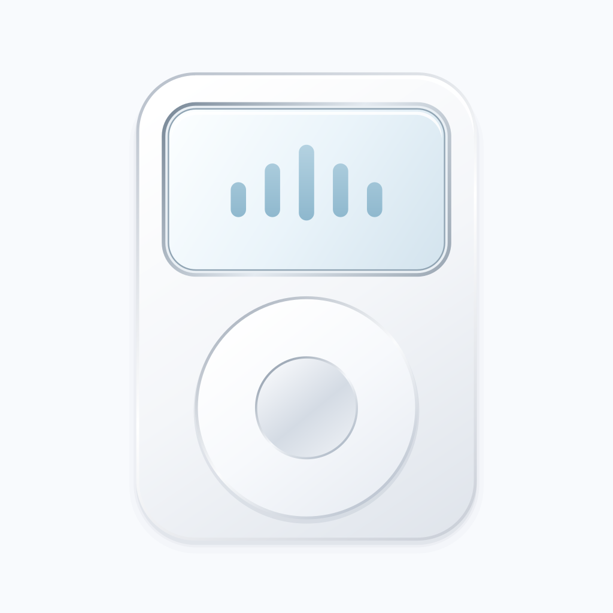
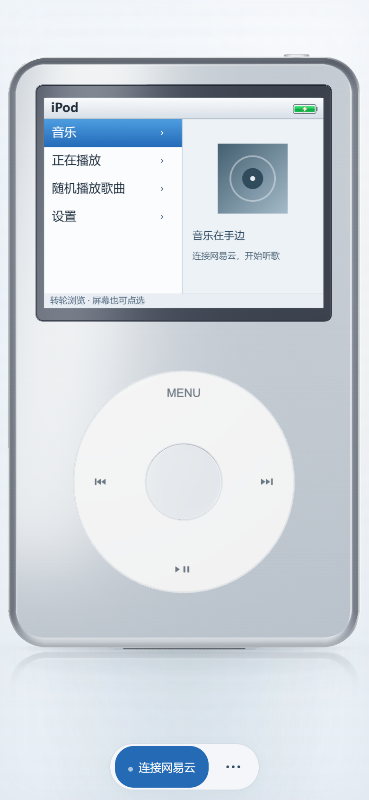
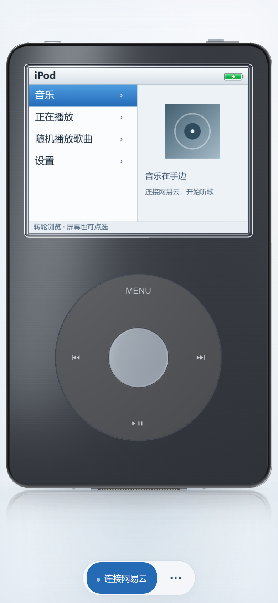

<p align="center">
  
</p>

<h1 align="center">Pocket Classic</h1>

<p align="center"><strong>把经典转轮、网易云音乐和本地曲库，装进口袋。</strong></p>

<p align="center">
  一款以 iPod Classic 为灵感的 Android 音乐播放器。<br>
  转动指尖选歌，倾斜手机感受金属光影，让听歌重新有一点仪式感。
</p>

<p align="center">
  <a href="https://github.com/Lsyn-18/Pocket-Classic/releases"></a>
  
  <a href="LICENSE"></a>
</p>

<p align="center">
  <a href="https://github.com/Lsyn-18/Pocket-Classic/releases"><strong>下载安装</strong></a> ·
  <a href="#快速上手">快速上手</a> ·
  <a href="#本地开发">本地开发</a> ·
  <a href="CHANGELOG.md">版本记录</a>
</p>

<p align="center">
  
  
</p>

Pocket Classic 将经典播放器的转轮操作与在线、本地音乐结合：登录网易云账号，收听喜欢的音乐、歌单、每日推荐和私人漫游；也可以导入手机里的音乐，离线播放。

Android 版可独立运行，**无需电脑、局域网服务或配对码**。三维界面随安装包提供，音乐由原生后台服务播放。

## 核心体验

| 特色 | 你可以体验到什么 |
| --- | --- |
| 经典转轮 | 沿转轮画圈浏览，中央键选择、MENU 返回；支持切歌、长按快进快退、HOLD 锁定与触感反馈。 |
| 网易云曲库 | 扫码登录，访问喜欢的音乐、我的歌单、每日推荐和私人漫游；歌单按云端保存顺序显示与入队，长列表支持继续加载。 |
| 本地离线播放 | 扫描手机音乐，或导入文件与文件夹；支持常见音频和标准 NCM，导入后的副本无需登录即可离线播放。 |
| 三维金属机身 | 银色与石墨黑平滑换色、细腻金属反光、高清 LCD、柔和倒影；支持三维封面浏览和主动展示运镜，开启体感后，机身随手机倾斜。 |
| 耳机接入动效 | 检测到耳机类音频输出时，显示虚拟插头插入与耳塞效果，断开后拔出。蓝牙耳机也会触发这一视觉效果。 |
| 原生播放 | Media3 后台播放与通知栏控制，私人漫游接近队列末尾时自动补歌；播放页支持专辑封面、歌曲详情和队列选择。 |
| 按习惯调整 | 机身颜色与明暗环境独立设置，支持跟随系统、大字菜单、减少动态效果和音质偏好；LCD 电量与手机实时同步。 |

另支持浏览网易云收藏 / 订阅的歌手，相关功能仍待真实账号联调。音质可选标准、极高、无损和 Hi-Res，实际可用资源取决于账号及歌曲权限。

## 快速上手

**运行要求：** Android 8.0 及以上、较新的 Android System WebView，以及支持 WebGL 2 的设备。在线音乐需要网络连接与网易云账号；本地离线播放无需登录。

先从 [Releases](https://github.com/Lsyn-18/Pocket-Classic/releases) 下载并安装 APK。安装后可连接网易云，也可直接进入「手机本地音乐」使用离线曲库。

### 连接网易云音乐

在同一部手机上扫码前，请先安装网易云音乐 App 并登录账号。

1. 点击播放器底部「连接网易云」，选择「保存并打开网易云」。
2. 在网易云音乐中打开「扫一扫 → 相册」，选择刚保存的二维码并确认授权，然后返回播放器。
3. 进入「音乐」，选择喜欢的音乐、我的歌单、每日推荐或私人漫游。

也可以使用另一部已登录网易云的设备扫码；二维码过期后重新生成即可。无法自动打开扫一扫时，可手动进入网易云音乐操作。Android 8 / 9 保存二维码时需要写入权限，应用不申请相册读取权限。

从 0.3.0 起，使用相同签名覆盖安装可保留本机加密会话；授权失效后需重新扫码。当前采用二维码授权，尚未接入网易云开放平台的正式一键授权流程，详见 [网易云接入说明](docs/NETEASE-ACCESS.md)。

### 播放本地音乐

进入「音乐 → 手机本地音乐」，选择扫描、导入文件或导入文件夹。支持 MP3、FLAC、M4A、AAC、WAV 等常见格式与标准 NCM，实际解码能力取决于 Android 系统。

**导入会保存应用内副本**，移除原文件后仍可播放；扫描发现的歌曲直接读取原件，需要保留原文件和读取权限。不支持读取其他应用的私有下载目录或 `.uc` 缓存。格式、权限和容量限制见 [离线音乐说明](docs/OFFLINE-MUSIC.md)。

## 当前版本与验证

当前版本为 **Android 0.11.0 独立测试版**，新增三维封面浏览、平滑换色和展示运镜，完善列表搜索、授权续接、故障恢复、本地曲库管理与长歌单原生续载。

- [下载 0.11.0 测试包](https://github.com/Lsyn-18/Pocket-Classic/releases/tag/v0.11.0)：附 SHA-256 校验文件和单文件外观预览。
- 该版本已通过 174 项 Node 检查、48 项安卓单元测试、APK 构建与 Lint；独立 Android 15 模拟器验证普通与 320px / 1.5 倍字体布局、封面、搜索、展示返回、简洁降级、本地管理、离线播放及播放错误传递。
- 按本轮安排先发布测试版，后补实际测试。**0.11.0 尚未完成真实账号、真实歌单后台续播、目标手机触摸与 TalkBack、长期耗电和发热验收**。历史真机结果不代表新版通过；多机型与耳机 / 音频焦点事件仍待专项验证。

详细记录见 [版本记录](CHANGELOG.md)、[设计改进与验证范围](docs/DESIGN-IMPLEMENTATION.md)、[真机记录](docs/DEVICE-TESTS.md) 和 [歌单排序说明](docs/PLAYLIST-ORDER.md)。

## 本地开发

Android 客户端使用 **Kotlin、Jetpack Compose 与 Media3**，三维界面使用 **Three.js 与 esbuild**。仓库另提供可选的 Node.js 浏览器预览服务。

### 浏览器预览

需要 **Node.js 22+**。在 Windows 中运行：

```powershell
git clone https://github.com/Lsyn-18/Pocket-Classic.git
cd Pocket-Classic
.\Start-Music-Service.cmd
```

启动后打开 [本地播放器](http://127.0.0.1:17863/)，点击「连接网易云」并扫码授权。其他系统可在项目根目录运行：

```sh
cd music-service
npm ci --ignore-scripts
npm start
```

浏览器播放期间需保持服务运行，服务重启后需重新扫码。手机浏览器使用体感通常需要 HTTPS。**这些电脑服务与浏览器限制不影响 Android 独立版运行。**

### 构建 Android

准备 **JDK 17、Android SDK Platform 35 和 Build Tools 35.0.0**，在 Android Studio 中打开 `android-player/`；或配置好 `JAVA_HOME` 与 Android SDK 后，在 Windows 项目根目录运行：

```powershell
.\Build-Android.ps1
```

脚本构建 Debug APK，并运行安卓单元测试与 Lint。当前产物为 `outputs/Pocket-Classic-0.10.5-debug.apk`。若已安装网页开发依赖，脚本会先更新安卓界面资源；否则使用仓库中已打包的资源。安装运行不需要 Node.js。

### 检查与界面打包

在项目根目录运行服务端与浏览器检查：

```sh
npm --prefix music-service test
npm --prefix web-model test
```

修改三维界面后重新打包：

```sh
cd web-model
npm ci --ignore-scripts
npm run build -- --publish --android
```

这里的 `--publish` 仅更新本地预览页面、安卓内置页面与 `outputs/` 中的单文件预览，不会上传或发布到 GitHub。不带该参数时仅生成 `web-model/dist/preview.html`。单文件预览主要用于查看外观，完整网易云功能需要运行本地服务。

### 项目结构

```text
android-player/          Android 独立客户端、网易云接入与原生媒体服务
web-model/               三维机身、播放器界面、交互与测试
music-service/           浏览器开发用音乐接口服务及早期兼容网关
docs/                    功能说明、开发文档与演示图
Start-Music-Service.cmd  Windows 浏览器预览启动入口
Build-Android.ps1        Windows 安卓构建与检查入口
```

更多实现细节见 [开发指南](docs/DEVELOPMENT.md)。

## 文档与后续计划

| 文档 | 内容 |
| --- | --- |
| [离线音乐](docs/OFFLINE-MUSIC.md) | 支持格式、导入方式、权限与副本管理 |
| [音乐选项](docs/MUSIC-OPTIONS.md) | 音质偏好、关注歌手与验证范围 |
| [耳机效果](docs/HEADPHONES.md) | 虚拟耳机外观、接入检测与兼容边界 |
| [网易云接入](docs/NETEASE-ACCESS.md) | 当前登录方式与官方平台接入区别 |
| [贡献指南](CONTRIBUTING.md) | 问题反馈、开发贡献与提交约定 |

接下来将继续完善多机型兼容性与长时间播放验证、调整转轮及体感手感，并探索歌词和网易云官方一键授权接入。

## 使用边界与隐私

Pocket Classic 是非官方项目，与 Apple、网易云音乐无关联。音乐按账号与版权权限提供，部分歌曲可能仅可试听或暂不可用；项目不提供替代音源或自动解灰。私人漫游目前使用私人 FM 推荐，尚未接入场景选择、红心和不感兴趣反馈。

Android 版由手机直接访问网易云当前接口，不依赖第三方公共 API 主机；上游接口变化可能需要更新应用。登录凭证通过 **Android Keystore 加密保存在本机**，不进入 JavaScript，也不上传开发者服务器。浏览器开发服务仅用于本机或可信局域网，不应暴露到公网。账号响应、登录截图与私人验证数据不提交到仓库。

## 开源许可

项目自有代码与文档采用 [MIT 许可证](LICENSE)，允许使用、修改、分发与商用，分发时请保留版权声明和许可证。第三方组件与相关内容保留各自许可及权利归属，详见 [开源使用要求](OPEN_SOURCE.md) 和 [第三方说明](THIRD_PARTY_NOTICES.md)。
