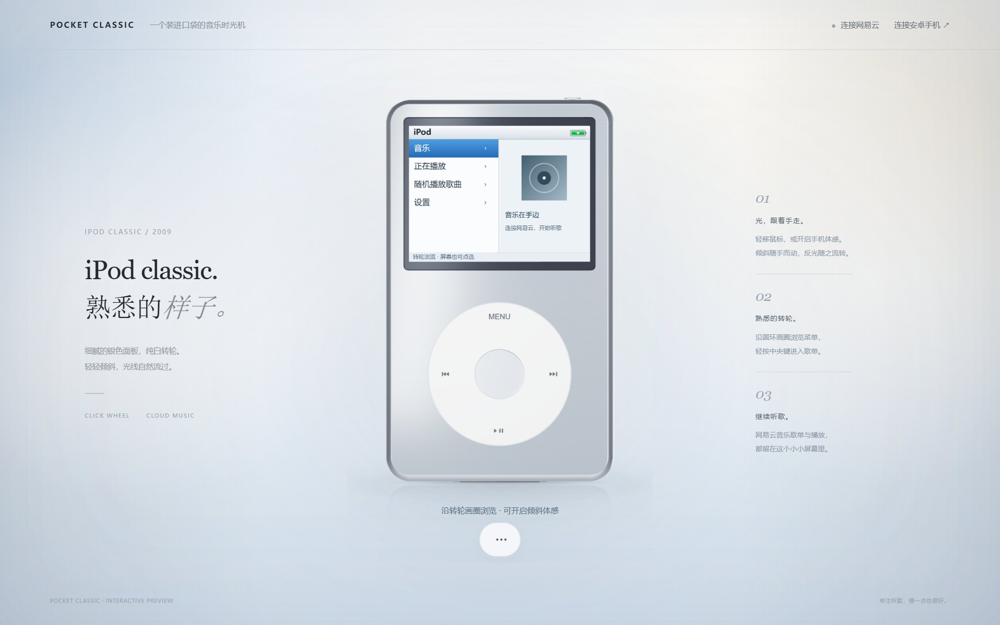
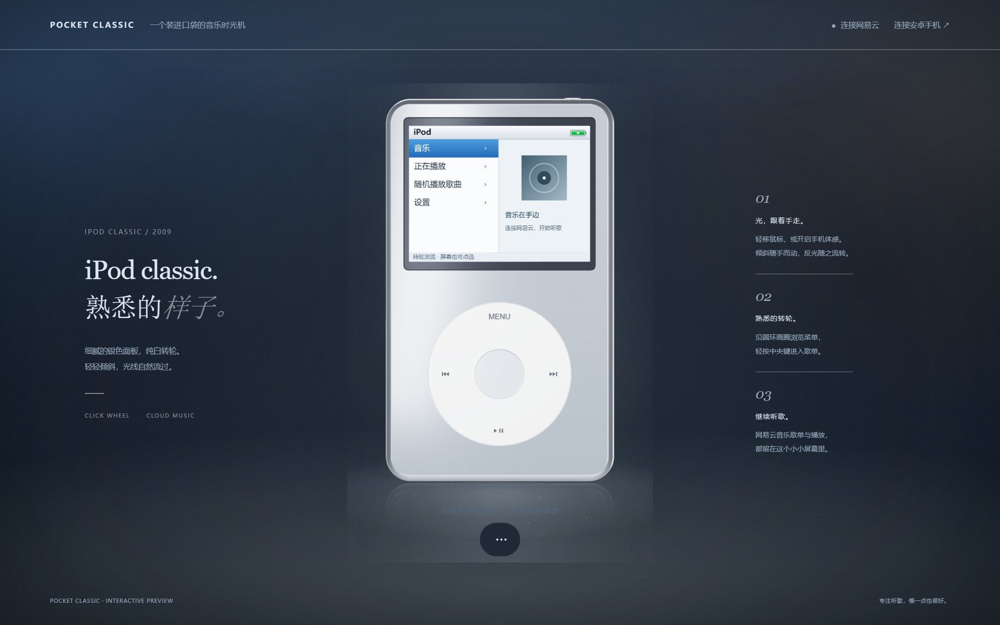
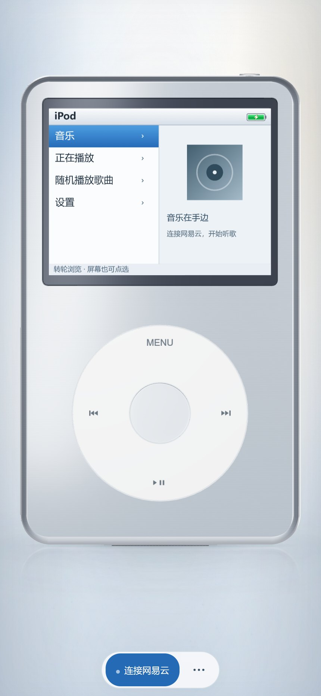
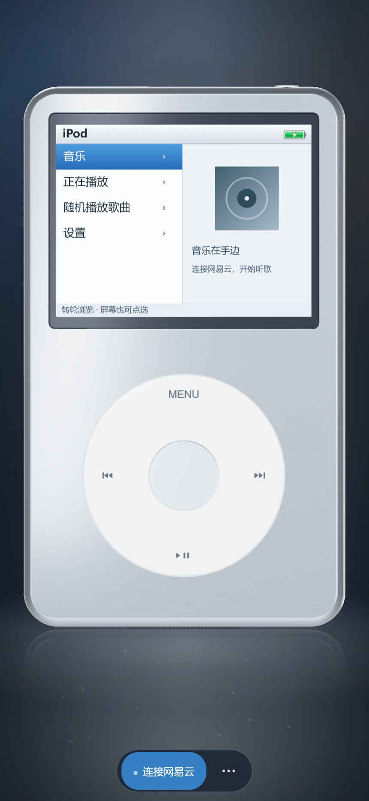

# 背景氛围与加载画报 · 0.9.0

依据《Pocket-Classic-背景氛围优化方案》（基于 0.7.3），在 0.8.2 的五视图模型、转轮开场与系统媒体音量同步上实现。用户选择同时保留画报和五秒转轮序章，因此顺序为 **加载画报 → 五秒转轮序章 → 播放器**。

## 落地对照

| 方案项目 | 实现 |
| --- | --- |
| P0 背幕 | 顶部柔光、冷侧补、暖反光、接触遮挡、曲目光池、上下渐变、两处文字保护区与暗角。另加中性侧缘压暗，使新版模型布局下的浅色取样对比达到目标范围。 |
| P0 主光 | 同一个全屏 quad 计算五个光叶，按权重归一化混色；静态峰值限制为浅色 .20、深色 .13，呼吸幅度 ±.12。 |
| P0 接地 | 三层阴影 6.1×.19、8.8×1.05、11.4×2.30；反射 .13、粗糙度至少 .74、衰减距离 1.30；地平线改为 23×.85 的柔光带；光池 10.8×2.45、浅色 .16 / 深色 .30。修复换色同步时反射粗糙度被原材质覆盖的问题。 |
| P0 手机构图 | 口径改为 `max(11.90,6.95/aspect)`。保留原有安全区、全屏高度修正、横屏工具栏和随投影计算的按键坐标。430px 视口计入左右 4px 内边距后，机身宽约 375px、左右约 27px。 |
| P0 三级提示 | L1 音量、定位及换曲使用电池位置，1.6 秒恢复；L2 底部 22px 浅色提示行，1.2 秒淡入淡出；L3 浅色卡，2.4 秒或“知道了”关闭。保留语音播报，连续定位时避免每 120ms 重复播报。 |
| P1 颗粒 | 140×140 内联 SVG、1.1 频率、浅色 .05 / 深色 .075，无外部图片请求，无额外 WebGL 纹理。 |
| P1 呼吸与视差 | 待机 12 秒、播放 8 秒；背景与机身以不同速度移动，背景视差系数 1.30；减少动态效果时停止呼吸与浮尘，保留静态背景。 |
| P1 浮尘 | 桌面与手机统一 76 点，2.2–5.8px × 渲染 DPR，不透明度 .10–.26；光锥内缓慢上浮，每秒 0.75% 画面高度，出生及离开时淡出。 |
| P1 加载画报 | 内联 55×92 SVG 线稿、字标、短句与准备线。首次或版本更新目标 1.4 秒，日常目标 .6 秒；实际模型尚未准备好时继续等待。准备线没有百分比，不作为下载进度。 |
| P2 文字保护与深色 | 同构背景采用独立深色配色，文字区保护层保持静态；机身颜色和背景主题可独立切换，地面明暗跟随背景，倒影材质跟随机身。 |
| P2 光温 | 曲目 ID 黄金比种子限制 accent 在 200–215°，饱和度 .20；同时缓慢调整主光日光色温约 ±300K，避免把金属染成彩色。 |

正文排版、字号、字重、栅格和断点保持原样。告警关闭按钮与 LCD 使用同一投影，并至少保留 44×44 CSS px 的触摸区域；支持 Tab 聚焦、Enter、Esc、安卓返回键。HOLD 下仍可关闭告警。失败消息在卡片消失后留在 LCD 页脚，可点按重试，完整信息和恢复操作也可在歌曲详情中查看。

## 画报与序章衔接

画报直接位于 HTML 中，在三维代码执行前即可显示。五秒时间轴等待原生偏好、着色器预热、首个实际 GPU 帧以及画报淡出完成后才开始；画报不会消耗转轮动画的五秒。保留触摸、键盘、安卓返回键跳过以及后台结束、不重播的行为。减少动态效果时只保留约 200ms 的交叉淡出。

安卓继续关闭网页存储，通过应用私有偏好保存单独的 `posterVersion` 标记；浏览器预览使用本地存储。仅在模型准备就绪后记忆版本。活动重建沿用已有的开场已播放标记。提前跳过时延迟释放仍在编译的开场资源，避免原先偶发的着色器预热错误。

## 验证

- 114 项 Node 检查、25 项安卓单元测试、APK 构建和 Lint 通过（0 错误、25 项既有警告）。
- 浏览器：1440×900@1.5 和 430×932@2 的浅色、深色抓帧；320×480、932×430 布局；完整开场、提前跳过、减少动态效果和基线模式；音量恢复电池、浅色提示、键盘与 HOLD 触摸关闭、真实静音音频长按定位和松开停止。
- 连续切换 16 次机身 / 背景颜色后纹理和几何资源数量稳定，无脚本错误、着色器错误或 WebGL 错误。桌面常态由 111 次绘制 / 27018 个三角面变为 112 / 27020，纹理仍为 14 张。新增成本来自第三层接地阴影。
- 小米 2210132C、Android 16、WebView 143：直接通过已安装的主应用检查十次应用音量调节、十次安卓媒体音量键、恢复电池、HOLD 告警触摸关闭、中央键和 MENU 真实触摸、完整画报衔接及跳过。测试结束恢复原媒体音量和外观偏好。
- 最终包可见转轮序章采样 5.01 秒，约 60.5fps，P95 16.6ms、最大 33ms；模型加载预热发生在画报遮挡期间。常态短时采样约 60fps。数据仅代表本机短时检查，未进行长时间发热测试。
- 手机拦截了辅助测试 APK 安装，本次未运行 instrumentation 测试；上述真机结论来自主应用实际桥接、系统按键和屏幕触摸，未把辅助测试标为通过。仓库中同步更新了相关自动测试。

亮度对照使用同一视口、同一取样点 8×8 像素均值：浅色设备上方 `(50%,6%)` 对右上边缘 `(97%,6%)`，桌面差约 22.3 级、手机约 25.2 级；0.8.2 对应约 −0.7 / +0.1 级。实际数值受曲目、体感位置和呼吸时刻影响。

原方案的“背景饱和度 ≤6%”与其给定的 RGB 渐变色值按 HSL 计算不一致。本版采用提供的配色示例、参考图和低饱和取色方向，不将严格 HSL 6% 或每一个背景像素的亮度上限列为已通过的数值验收。

## 实际预览

| 桌面浅色 | 桌面深色 |
| --- | --- |
|  |  |

| 手机浅色 | 手机深色 |
| --- | --- |
|  |  |
