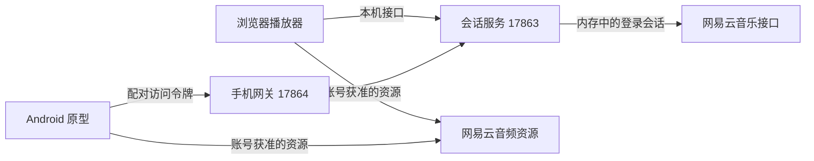

# 开发指南

## 开发环境

| 部分 | 版本或要求 |
| --- | --- |
| 音乐服务 | Node.js 22+，npm |
| 三维界面 | Three.js 0.182.0，esbuild 0.25.12 |
| 网易云社区接口 | `@neteasecloudmusicapienhanced/api` 4.41.1 |
| Android | JDK 17，SDK Platform 35，Build Tools 35.0.0，最低 API 26 |
| 安卓构建 | Gradle Wrapper 8.11.1，AGP 8.9.2，Kotlin 2.1.20 |
| 安卓播放 | Media3 1.6.1 |

依赖版本由两个 `package-lock.json` 及安卓构建文件固定。不要将本机 SDK 路径或登录凭证写入源码。

## 服务关系



浏览器在本机直接使用会话服务；Android 原型通过配对网关访问。网关不向客户端导出网易云登录 cookie，只转发允许的接口并清理凭证字段。会话服务仅监听本机地址，网关用于同一可信局域网内的手机连接。

当前并非脱离电脑独立运行的安卓应用。不要把已经在浏览器实现的功能误认为已集成到 APK。

## 运行服务

Windows 可直接双击根目录 `Start-Music-Service.cmd`。该入口会检查依赖，并复用已经运行的服务，避免每次启动都丢失内存中的登录状态。

手动运行：

```sh
cd music-service
npm ci --ignore-scripts
npm start
```

- `17863`：扫码登录、浏览器播放器和本机音乐接口。
- `17864`：手机配对页面、网关和本地构建 APK 的下载入口。
- `17866`：可选的独立页面检查服务。

会话和配对令牌均保存在进程内存中。修改服务端代码后需要重启相应进程，可能需要重新扫码或配对；修改浏览器界面并重新发布页面无需重启音乐服务。

## 修改浏览器界面

```sh
cd web-model
npm ci --ignore-scripts
npm run build
```

构建只生成 `dist/preview.html`。在项目根目录运行 `node web-model/preview-server.cjs`，即可在 `http://127.0.0.1:17866/` 检查页面；音乐接口转发到正在运行的 `17863` 服务。

确认后运行 `npm run build -- --publish`，更新 `music-service/index.html` 以及 `outputs/Pocket-Classic-3D.html`。服务每次请求页面时读取当前文件，因此刷新浏览器即可看到更新。

关键文件：

- `main.mjs`：浏览器入口，先加载播放器逻辑，再初始化三维界面。
- `player.mjs`：菜单、账号、播放状态与队列切换。
- `roam-stream.mjs`：漫游批次请求、最近歌曲去重和旧会话结果丢弃。
- `geometry.mjs`：机身、转轮、屏幕和材质。
- `screen.mjs`：将实时菜单和播放状态绘制到屏幕纹理。
- `studio-floor.mjs`：三维镜像倒影、距离渐隐和柔和接触阴影。
- `motion.mjs`：姿态授权、自然姿势校准、死区、平滑与限幅。
- `front-view.mjs`：相机自适应、射线点击、转轮手势与辅助工具。
- `player-template.html`、`front.css`：页面结构与手机布局。

`viewer.mjs` 和 `model.css` 是早期全角度模型查看器，未被当前入口引用；当前产品使用固定正面视角。

## 体感参数

| 参数 | 当前值 |
| --- | --- |
| 手持死区 | 3° |
| 额外倾斜幅度上限 | 合计 2.2° |
| 平滑时间常数 | 0.55 秒 |
| 滤波结果速度上限 | 1.8°/秒 |
| 初次校准 | 稳定约 450 毫秒且至少 8 个有效样本 |

读取相对的 beta/gamma 姿态，忽略罗盘朝向；横竖屏切换或页面恢复后重新校准。转轮操作期间冻结视角。浏览器通常要求安全上下文，手机访问局域网 HTTP 页面时不能保证提供姿态数据，最终手感仍待真机验证。

## 推荐接口

| 本地路径 | 方法 | 用途 |
| --- | --- | --- |
| `/api/status` | GET | 当前本机会话状态 |
| `/api/playlists` | GET | 账号歌单 |
| `/api/tracks?id=...` | GET | 歌单歌曲 |
| `/api/daily` | GET | 每日推荐，按会话短时缓存 |
| `/api/roam` | GET | 新的私人 FM 推荐批次 |
| `/api/resolve` | POST | 解析账号允许的歌曲资源 |

手机网关只允许配对客户端调用以上白名单接口，不开放扫码、退出登录或任意上游路径。日推和漫游入口要求有效登录；它们没有公共歌单回退，也不会把其他账号的推荐缓存用于当前会话。

## 检查

在根目录运行所有服务端与浏览器逻辑检查：

```sh
node --test music-service/discovery.test.cjs music-service/gateway.test.cjs web-model/motion.test.mjs web-model/roam-stream.test.mjs web-model/player.test.mjs
```

当前共 38 项，覆盖访问控制、凭证清理、推荐缓存、会话切换、漫游去重、并发续歌、过期响应隔离、播放流程和体感滤波。检查使用合成数据，不需要网易云账号；实际账号联调属于单独的手动验证。

安卓检查：

```powershell
cd android-player
.\gradlew.bat :app:assembleDebug :app:testDebugUnitTest :app:lintDebug
```

Android Studio 中配置 SDK 即可；命令行构建可以设置 `ANDROID_HOME`，或在被 Git 忽略的 `android-player/local.properties` 中填写本机 `sdk.dir`。不要上传该文件或调试签名密钥。

## 保存与提交

`music-service/index.html` 作为可直接运行的预构建页面保留在仓库中。修改浏览器源码后，应重新运行发布构建并一起提交此页面。

`work/`、`outputs/`、`runtime/`、依赖、SDK、构建缓存、安装包和签名文件不提交。文档演示图应由不登录的中性界面生成，避免上传个人歌单、账号名称或登录二维码。
