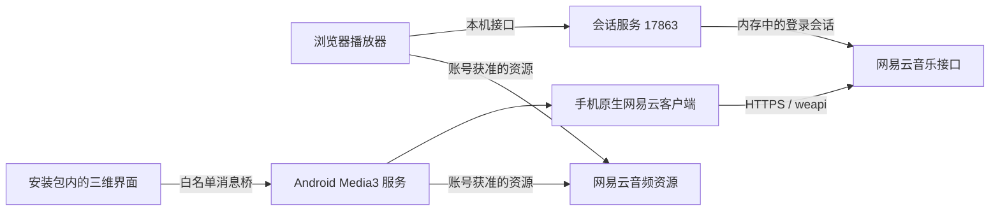

# 开发指南

## 开发环境

| 部分 | 版本或要求 |
| --- | --- |
| 可选浏览器音乐服务 | Node.js 22+，npm；安卓安装运行不需要 |
| 三维界面 | Three.js 0.182.0，esbuild 0.25.12 |
| 网易云社区接口 | `@neteasecloudmusicapienhanced/api` 4.41.1 |
| Android | JDK 17，SDK Platform 35，Build Tools 35.0.0，最低 API 26 |
| 安卓构建 | Gradle Wrapper 8.11.1，AGP 8.9.2，Kotlin 2.1.20 |
| 安卓播放 | Media3 1.6.1 |

依赖版本由两个 `package-lock.json` 及安卓构建文件固定。不要将本机 SDK 路径或登录凭证写入源码。

## 服务关系



安卓 0.3.0 直接连接网易云，二维码申请、授权轮询、歌单、推荐及音源解析都由 Kotlin 完成。网易云 cookie 和账号信息由 Android Keystore 加密保存在本机；不进入 WebView 或 JavaScript，不导出到开发服务器。旧的地址和配对凭证在升级时移除。

三维界面继续共用菜单、转轮、材质、倒影和自适应逻辑。WebView 只加载固定的本地资源地址，禁止其他导航和网络资源；白名单消息桥把选歌、音量和姿态请求交给 Kotlin。音频资源地址不会进入 JavaScript。

Media3 服务负责音频、通知栏、音频焦点及漫游队列续歌；界面停止后仍可播放。安卓原生旋转向量传感器输出 beta/gamma，再复用浏览器的校准、死区及平滑逻辑。安卓不需要电脑服务，默认禁止局域网 HTTP 请求；仅为网易云音频 CDN 保留明文兼容例外。

0.3.1 增加设备反馈：`NativeBattery` 在前台监听系统电量广播，首次加载与回到前台时同步当前值；不需要新增权限。`NativeHaptics` 使用现有 VIBRATE 权限调用马达，优先使用系统轻触效果，回退到 8 毫秒脉冲并限制重复频率；由播放器的「触感反馈」控制。

专辑封面与专辑名在歌曲列表、原生队列和状态同步中保留。`NativeArtwork` 仅接受网易云 `p1` 至 `p9.music.126.net` 的 HTTPS 图片，限制下载体积和解码尺寸、禁止跳转，并缓存 320 像素缩略图。图片以 data URL 返回，不向 WebView 开放网络或账号凭证。`artwork.mjs` 按当前封面键读取，避免旧封面晚到覆盖新歌；浏览器使用匿名跨域图片，加载失败保留占位图。

原生关键文件：`NetEaseCrypto.kt` 负责编码请求；`NetEaseApi.kt` 直连网易云并清理返回给界面的字段；`MusicSessionStore.kt` 加密保存会话；`NetEaseLoginDialog.kt` 和 `LoginQrImage.kt` 生成授权界面与保存本次二维码。二维码授权完成后才保存会话，旧登录任务和旧账号请求均有代次隔离。

正式一键唤端登录需开放平台 AppId、应用登记信息、回调域名及网易云配置的回跳 Scheme，返回的官方令牌与当前社区接口 cookie 不互通，后续音乐接口也要配套接入。官方文档建议在服务端兑换和刷新令牌；可使用云函数而非个人电脑，具体以应用获准的接入方式为准。

需先区分个人 CLI 应用与厂商移动应用：官方 FAQ 当前规定个人场景仅提供 ncm-cli，不能仅凭个人控制台 AppId 和密钥判断可直接接入原生移动 API 或官方一键授权。详见 [网易云接入类型](NETEASE-ACCESS.md) 及其中的官方来源。

## 运行可选的浏览器开发服务

以下服务不参与安卓独立版运行，旧手机配对网关仅保留作早期版本兼容和浏览器调试用途。

Windows 可直接双击根目录 `Start-Music-Service.cmd`。该入口会检查依赖，并复用已经运行的服务，避免每次启动都丢失内存中的登录状态。

手动运行：

```sh
cd music-service
npm ci --ignore-scripts
npm start
```

- `17863`：扫码登录、浏览器播放器和本机音乐接口。
- `17864`：手机配对页面、网关和本地构建 APK 的下载入口。
- `17866`：可选的独立页面检查服务。

会话和配对令牌均保存在进程内存中。修改服务端代码后需要重启相应进程，可能需要重新扫码或配对；修改浏览器界面并重新发布页面无需重启音乐服务。

## 修改浏览器界面

```sh
cd web-model
npm ci --ignore-scripts
npm run build
```

构建只生成 `dist/preview.html`。在项目根目录运行 `node web-model/preview-server.cjs`，即可在 `http://127.0.0.1:17866/` 检查页面；音乐接口转发到正在运行的 `17863` 服务。

确认后运行 `npm run build -- --publish --android`，更新 `music-service/index.html`、`outputs/Pocket-Classic-3D.html` 以及 `android-player/app/src/main/assets/player.html`。服务每次请求页面时读取当前文件，因此刷新浏览器即可看到更新；安卓需要重新构建并安装 APK。

关键文件：

- `main.mjs`：浏览器入口，先加载播放器逻辑，再初始化三维界面。
- `player.mjs`：菜单、账号、播放状态与队列切换。
- `native-platform.mjs`：安卓消息桥、原生播放状态镜像和传感器生命周期。
- `roam-stream.mjs`：漫游批次请求、最近歌曲去重和旧会话结果丢弃。
- `wheel-input.mjs`：共用转轮步进，约 0.40 弧度切换一项，连续步进间隔至少 110 毫秒，不累计快速滑动的额外跳项。
- `artwork.mjs`：封面来源检查、加载缓存与异步结果隔离。
- `geometry.mjs`：机身、转轮、屏幕和材质。
- `screen.mjs`：将实时菜单和播放状态绘制到屏幕纹理。
- `battery.mjs`：绘制细灰银边框、绿色电芯、低电量配色及充电闪电，继续使用真实设备电量。
- `studio-floor.mjs`：三维镜像倒影、距离渐隐和柔和接触阴影。
- `motion.mjs`：姿态授权、自然姿势校准、死区、平滑与限幅。
- `front-view.mjs`：相机自适应、射线点击、转轮手势与辅助工具。
- `player-template.html`、`front.css`：页面结构与手机布局。

`viewer.mjs` 和 `model.css` 是早期全角度模型查看器，未被当前入口引用；当前产品使用固定正面视角。

## 体感参数

0.3.2 的银色面板使用金属度 0.88、粗糙度 0.30，并以轻微的各向异性表现定向光泽；圆弧边缘独立使用 0.23 粗糙度，中央键为 0.36。转轮继续使用哑光材质。摄影棚环境加入长条灯和暗部反射卡，正前方的窄面光源提供面板上的宽亮带；反射由真实视角及光照计算，继续使用以下低灵敏度体感参数。

0.3.3 将正面边缘的可见滚边从 0.20 收窄到 0.10 模型单位，同时将平整面板扩展到与滚边衔接的位置；保持机身外轮廓及屏幕、转轮位置。边缘金属度改为 0.68、粗糙度改为 0.36，减弱厚重暗带，面板的金属材质和高光照明保留。

| 参数 | 当前值 |
| --- | --- |
| 手持死区 | 3° |
| 额外倾斜幅度上限 | 合计 2.2° |
| 平滑时间常数 | 0.55 秒 |
| 滤波结果速度上限 | 1.8°/秒 |
| 初次校准 | 稳定约 450 毫秒且至少 8 个有效样本 |

读取相对的 beta/gamma 姿态，忽略罗盘朝向；横竖屏切换或页面恢复后重新校准。转轮操作期间冻结视角。浏览器通常要求安全上下文，手机访问局域网 HTTP 页面时不能保证提供姿态数据，最终手感仍待真机验证。

## 推荐接口

| 本地路径 | 方法 | 用途 |
| --- | --- | --- |
| `/api/status` | GET | 当前本机会话状态 |
| `/api/playlists` | GET | 账号歌单 |
| `/api/tracks?id=...` | GET | 歌单歌曲 |
| `/api/daily` | GET | 每日推荐，按会话短时缓存 |
| `/api/roam` | GET | 新的私人 FM 推荐批次 |
| `/api/resolve` | POST | 解析账号允许的歌曲资源 |

手机网关只允许配对客户端调用以上白名单接口，不开放扫码、退出登录或任意上游路径。日推和漫游入口要求有效登录；它们没有公共歌单回退，也不会把其他账号的推荐缓存用于当前会话。

## 检查

在根目录运行所有服务端与浏览器逻辑检查：

```sh
node --test music-service/discovery.test.cjs music-service/gateway.test.cjs web-model/motion.test.mjs web-model/roam-stream.test.mjs web-model/player.test.mjs web-model/native-platform.test.mjs web-model/wheel-input.test.mjs web-model/artwork.test.mjs
```

逻辑检查覆盖访问控制、凭证清理、推荐缓存、会话切换、漫游去重、并发续歌、过期响应隔离、原生消息桥、播放流程和体感滤波。检查使用合成数据，不需要网易云账号；实际账号联调单独验证。

安卓检查：

```powershell
cd android-player
.\gradlew.bat :app:assembleDebug :app:testDebugUnitTest :app:lintDebug
```

Android Studio 中配置 SDK 即可；命令行构建可以设置 `ANDROID_HOME`，或在被 Git 忽略的 `android-player/local.properties` 中填写本机 `sdk.dir`。不要上传该文件或调试签名密钥。

安卓单元测试覆盖接口与资源白名单、旋转矩阵转换、漫游去重、旧会话隔离和请求编码的独立 Node.js 向量。`MusicSessionStoreTest` 在隔离的测试偏好存储中验证加密会话重建、退出、旧网关凭证迁移与局域网 HTTP 限制，不覆盖用户当前会话。

`StandaloneLoginTest` 在安卓真实界面生成二维码，使用 `authorize=true` 参数显式启动需要用户确认的直连账号联调；默认跳过此交互测试。它验证账号、歌单、日推、漫游和音源解析，无需电脑地址或配对码。`IntegratedPlayerTest` 默认验证本地三维界面与触摸，提供 `authenticated=true` 时继续验证已有手机会话下的日推原生解码、漫游前台和后台跨批次续歌及横竖屏切换。上游歌曲可用性受账号权限影响，私人响应与登录截图不提交。

`DeviceFeaturesTest` 使用合成图片验证安卓实际解码、缩略图缓存与队列封面元数据传递。未登录的 `IntegratedPlayerTest` 还会临时改变测试设备的系统电量并确认界面更新，结束后恢复系统电池状态；只在开发者的隔离模拟器运行，不在用户手机上自动执行此测试。实体震感和真实 CDN 下载不由这些离线检查代替。

0.2.0 曾在 Android 15 模拟器通过电脑网关完成完整播放联调；0.3.0 的独立登录与账号接口需要新的手机会话授权，验证状态须单独记录，不继承旧结果。真机体感与性能仍待验证。

## 保存与提交

`music-service/index.html` 和安卓 `assets/player.html` 作为可直接运行的预构建页面保留在仓库中。修改共用界面后，应重新运行发布构建并一起提交这两个页面。

`work/`、`outputs/`、`runtime/`、依赖、SDK、构建缓存、安装包和签名文件不提交。文档演示图应由不登录的中性界面生成，避免上传个人歌单、账号名称或登录二维码。
