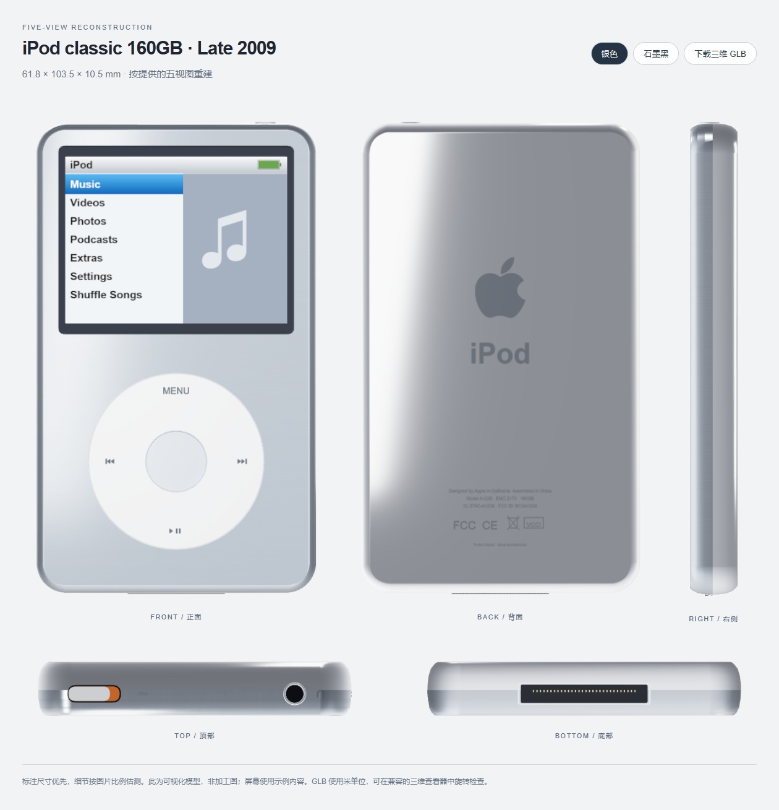

# 五视图模型重建

本轮按照用户提供的「iPod classic 160GB · Late 2009」正面、背面、右侧、顶部和底部参考图重建。标注尺寸优先；图片各视图的像素缩放并不完全一致，因此未标尺寸的细节按比例估测，并保持 LCD 的 4:3 比例。模型用于播放器与视觉展示，不是制造用 CAD。

## 尺寸与结构

| 部件 | 重建方式 |
| --- | --- |
| 主体尺寸 | 宽 61.8、高 103.5、厚 10.5 mm；源码单位为厘米，GLB 导出为米 |
| 铝前盖 | 较大的圆角、连续曲面过渡与独立平面，和钢背壳在侧面分缝 |
| 钢背壳 | 分层截面构成弧形卷边与中央背板，保留抛光金属反射 |
| 屏幕 | 缩窄外框并重排位置，采用黑色圆角边框，内置 LCD 与触摸坐标同步 |
| 转轮 | 重新定位圆形转轮与独立中央键，保留覆盖开孔的托盘，避免后壳从细缝露出 |
| 顶部 | HOLD 位于左侧，带胶囊形滑块与橙色指示；耳机孔在右侧，附位置标识 |
| 底部 | 居中的 30 针接口、内舌与独立金色接点，移除参考图中没有的外露螺丝 |
| 背面 | 重排图标、iPod 字样、型号文字与标识；额外的小字标明可视化重建 |

商标、标识及产品外观所涉权利仍归其权利人所有，本项目不是官方产品。参考图片不随仓库重新分发。GLB 的 LCD 使用固定示例内容，不含账号、歌单或登录信息。

## 生成与获取

安装 `web-model` 依赖后，在项目根目录运行：

```sh
node tools/build-reference-review.mjs
```

打开 `outputs/Pocket-Classic-five-view.html`，可查看五个正交视图、切换配色并下载相应 GLB。网页使用同一个模型生成各个方向，不是把参考图片贴到模型上。导出会把程序生成的原始贴图转换为可嵌入 glTF 的图片，并保留材质与几何数据。

[Releases](https://github.com/Lsyn-18/Pocket-Classic/releases) 提供银色 / 黑色 GLB、五视图 HTML / PNG 及安卓安装包。GLB 可在支持 glTF 2.0 的三维查看器中旋转查看。

## 同步修复

- 顶部 HOLD 在正面视角下接近侧立，采用独立触摸区域，避免新外形导致点不中。
- 安卓体感直接传递四元数，以校准姿态计算相对转动，避开接近竖直拿握时欧拉角翻转造成的机身跳动；保留直接跟随和原倾斜幅度。浏览器仍兼容原有姿态事件。

## 验证

96 项 Node 检查、20 项安卓单元测试、构建与 Lint 通过。检查主体边界、分缝、顶部左右布局、4:3 LCD、30 个接点，以及轮盘遮挡、换色贴图复用、四元数符号等价性和接近竖直姿态的连续性。两份 GLB 导出成功并验证 glTF 2.0 文件头，独立网页无脚本错误。

小米 Android 16 实际点按中央键、MENU、屏幕菜单、换色与左侧 HOLD 通过；横竖屏帮助回归通过。用户重复查看整机上方并左右晃动后确认“不跳了，动作连续”。细节估测不作为加工尺寸或跨机型性能保证。


