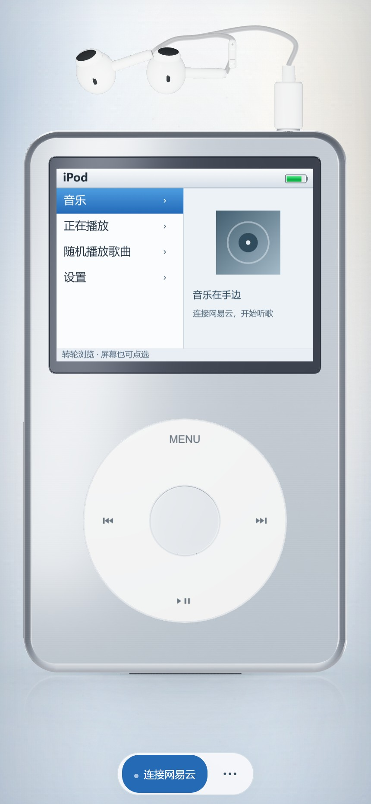

# 耳机接入效果 · 0.10.0

安卓检测到耳机类音频输出后，白色直式 3.5mm 插头沿 iPod 顶部插孔插入，细线连接一对小型硬壳耳塞与线控。无线耳机也触发这一虚拟有线效果；手机的实际音频输出仍由系统管理。

## 外观与动作

先核对苹果官方 3.5mm EarPods 产品图和说明，再制作原创几何模型。参考采用白色硬壳、黑色出音口、银色触点和三道浅色绝缘环。耳塞比首版草模缩小 32%，线缆收成上方短弧线与紧凑 Y 形分线，减少占用的画面空间。

没有找到可核实的苹果官方 3.5mm 插接动画。此处按机械插接过程自行设计：约 1.08 秒沿孔轴插入、护套落座，线缆小幅滞后并停稳；约 0.64 秒拔出。快速切换连接时从当前进度反向，重复连接回调不重新播放。官方产品照片不随应用分发，详见 [调研与来源](HEADPHONE-RESEARCH.md)。

## 如何查看

- 安卓前台连接有线、USB 或蓝牙耳机，触发接入；最后一个耳机类输出断开时拔出。
- 没有安卓设备或耳机时，打开单文件应用预览，选择「更多 → 预览耳机接入」。预览约 4.6 秒后恢复真实连接状态，不创建真实音频连接，也不修改音量或播放状态。
- 开启「减少动态效果」时，连接变化直接切换静态效果。

冷启动若已连接耳机，动画等待画报和五秒转轮序章结束后再开始；普通返回保持原状态，同进程界面重建直接恢复已接入姿态。操作转轮或按键时暂停插接进度与取景变化，避免操作目标移动。退到后台时取消预览并落定到真实连接状态；回来后重新读取输出设备。

## 检测范围

通过 Android `AudioDeviceCallback` 与 `AudioManager.getDevices(GET_DEVICES_OUTPUTS)` 观察连接输出，不扫描附近设备、不读取蓝牙名称或地址、不增加蓝牙扫描、定位或麦克风权限。

| 系统输出类型 | 处理 |
| --- | --- |
| 有线耳机、带麦有线耳机 | 显示接入 |
| USB 耳机、通用 USB 音频设备 | 显示接入 |
| 经典蓝牙 A2DP / SCO、BLE 耳机、助听设备 | 显示接入 |
| 手机扬声器、听筒、HDMI、明确标记的 BLE 音箱 | 不触发 |

经典 A2DP 与部分通用 USB 音频在公共接口中也可能代表音箱。当前不申请额外权限的方案无法严格区分这些设备，连接这类音箱也可能显示耳机效果；这是连接设备检测，并非对音乐此刻实际路由的强制选择。

## 本轮验证

验证使用实际打包的安卓页面、Chrome 与模拟原生消息，**没有安卓真机**，不能替代有线拔插、蓝牙重连、多设备切换和系统厂商行为的实际测试。

- 123 项 Node 检查与 33 项安卓单元测试通过，包含连接分类、初始状态缓存、连续反向、重复回调、减少动态效果和预览恢复。
- 安卓 Debug APK、测试 APK 与 Lint 构建通过；Lint 为 0 错误、26 项已有警告。
- 浏览器模拟验证开场期间隐藏耳机、开场后接入、同进程重建直接恢复、转轮按住时取景固定、连接类型切换不重播，以及断开 / 重连连续变化。
- 浏览器预览入口通过；320×480、430×932、932×430、1440×900 尺寸无页面溢出。
- 多次切换连接后几何体和纹理数量稳定。模拟安卓连接场景为 123 次绘制、37,896 个三角形、14 张纹理与 75 个几何体，着色器错误和 WebGL 错误均为零；这是场景预算记录，不代表手机实测帧率。

原有音量同步、播放队列、相对四元数体感与 [仅冷启动显示开场的规则](STARTUP-PROCESS.md) 保持原有行为。
