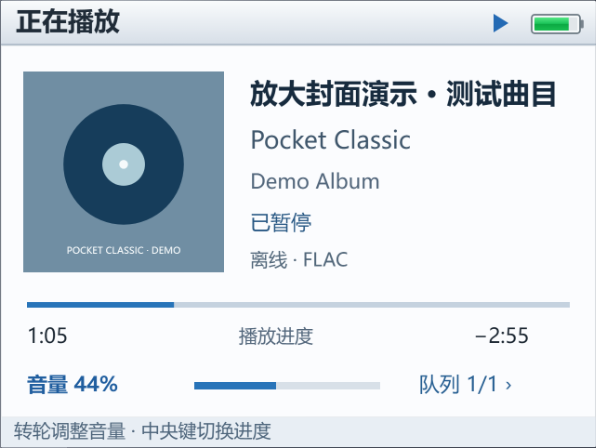
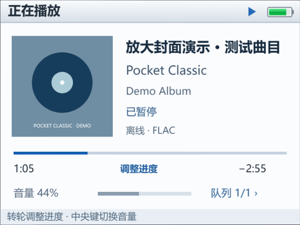

# 0.9.2：冷启动开场与播放页调整

## 开场规则

画报和五秒转轮序章只在应用进程被清理后重新启动时出现。0.9.1 曾把再次点击桌面图标也设为触发入口，这一行为已撤回。

| 场景 | 画报 / 转轮序章 |
| --- | --- |
| 应用进程被系统回收或被清理后重新启动 | 显示一次。 |
| 应用仍在后台，再次点击桌面图标 | 不显示，继续现有播放器。 |
| 最近任务、通知返回、重新获得焦点 | 不显示。 |
| 同一进程内重建 Activity 或 WebView | 不显示。 |
| 冷启动且开启减少动态效果 | 保留静态画报，等模型准备完成后淡出；跳过转轮运镜。 |

`OpeningSession.process` 仅在进程内存中保存已显示标记，所有活动和页面共享。不写入永久“已播放”偏好，进程结束后新进程自然获得新标记。首次创建原生页面时领取标记，保留任务不再通过桌面 Intent 重载页面；暖重建返回的 HTML 在首次绘制前隐藏开场元素，避免静态画报闪现。

如果音乐服务仍让应用进程保持运行，仅移除某个界面并不等于进程已经被清理。此时重新创建界面也不重播。画报版本记忆只控制首次 / 日常画报时长，不改变冷启动触发规则。

## 播放页

- 专辑封面从逻辑 90×90 放大到 108×108，边长增加 20%；右侧歌曲信息移动到 x=134，并把播放状态和音质分行。保留原有字号和长歌名滚动。
- 封面下缘的详情点击区域同步扩大；播放进度 / 音量切换区域从 y=154 开始，避免点放大后的封面却切换模式。
- 切换进度 / 音量不再创建临时反馈层。当前模式通过进度文字、音量文字颜色和浅色页脚说明表达，不遮挡进度线、音量条和电池。
- 转动转轮时的数值仍显示在顶栏；切换模式本身不修改播放位置或音量，保留读屏播报。错误和 HOLD 仍使用原来的浅色告警卡。

以下使用演示封面，分别为音量模式与进度模式：

| 音量 | 进度 |
| --- | --- |
|  |  |

## 验证

- 117 项 Node 检查通过：包括放大封面下缘点击、进度 / 音量控件、切换模式不创建反馈层，以及静态画报的减少动态效果回归。
- 28 项安卓单元测试通过：包括同进程共享开场标记、新进程获得新标记，以及并发页面只能领取一次开场。
- 使用实际安卓内置 HTML 与模拟原生桥接，验证冷进程开场、普通返回不重播、同进程重建不闪画报、新进程再次显示；检查真实图片覆盖到新封面边缘、封面详情点击、四次中央键切换、播放位置和音量保持、普通与大字模式。
- APK、测试包构建及 Lint 通过，0 错误、26 项既有警告。
- **本轮没有安卓设备，未进行覆盖安装、后台进程清理、真实桌面或通知返回的真机复验。** 浏览器的模拟进程不等于安卓实际进程回收。

设备测试已按新规则更新并编译。动画分支在测试进程内重置标记以创建独立场景，不能把这一测试准备步骤当成真实进程清理的验证。

## 有设备后的复验

1. 应用进程清理后打开，确认画报与完整转轮序章；播放过或跳过后按 HOME，再从桌面、最近任务和通知分别返回，均应直接继续播放器。
2. 再清理进程后打开，确认重新出现一次开场；同一进程内旋转或重建页面不重复显示。
3. 打开歌曲，检查放大的封面及右侧文字；点击封面最下缘应进入详情。
4. 连续切换进度 / 音量，检查没有黑色框或临时浮层，位置与音量未改变；随后分别转动转轮，确认只调整当前选择的项目。
5. 开启减少动态效果进行冷启动，确认静态画报保留，转轮运镜跳过。还原测试前偏好。
