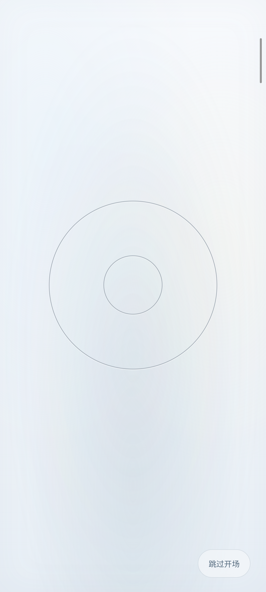
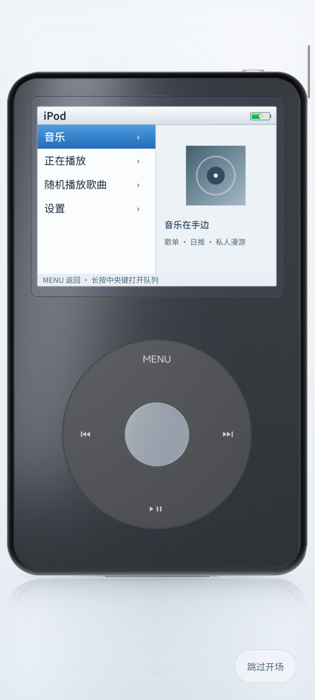

# 转轮序章：当前选定的开场设计

更新日期：2026-11-08。

**当前 0.9.2 规则**：仅在应用进程被清理后重新启动时显示画报与五秒序章；再次点击桌面图标、普通任务恢复、通知返回和同进程重建都不重播。减少动态效果保留静态画报。下方真机数据为历史版本记录；本轮没有安卓设备，验证范围与复验步骤见 [冷启动开场与播放页调整](STARTUP-PROCESS.md)。

Android **0.8.1** 已按最新五视图模型整合「转轮序章」，采用 **两圈银环 → 同尺寸真实转轮 → 缩小展示整机** 的顺序。此前的环绕运镜预览保留为探索记录。

## 顺序与节奏

| 默认时间 | 画面 |
| --- | --- |
| 0.00–0.70 秒 | 同时出现两圈细银环，分别对应转轮外缘与中央键边缘 |
| 0.70–1.50 秒 | 在完全相同的位置与大小显现真实转轮，银环逐渐交接给真实材质 |
| 1.50–1.80 秒 | 保持转轮特写大小，短暂观察材质和按键 |
| 1.80–3.70 秒 | 连续拉远，转轮逐渐缩小，周围机身显现，直至展示完整播放器 |
| 3.60–4.20 秒 | LCD 背光点亮并进入菜单 |
| 4.20–5.00 秒 | 整机稳定停留，LCD 已完全亮起 |

## 实现要点

- 使用正面正交相机，机身保持直立。
- 真实转轮使用播放器当前的 `createClassic` 模型，主体为 61.8 × 103.5 × 10.5 mm。根据 `geometry.mjs` 实时计算轮廓：外圈半径 1.931，对应外缘柔光唇；内圈半径 0.677，对应中央键外侧接缝；转轮中心 Y 为 −2.28。
- 银环和真实转轮从同一几何尺度、同一相机投影计算位置与直径。轮廓交接期间固定相机，直到真实转轮完全出现后才开始缩放。
- 初始遮罩只显示转轮区域。拉远时周围机身柔和显现，不再缩放圆环后跳到整机。
- 通过对数尺度的平滑变化拉远，构图中心从转轮平滑移动到整机。
- 实际启动总时长固定 5 秒，最后 0.8 秒保持机位、姿态和 LCD 亮度稳定。结束构图直接使用播放器自身的适配结果，工具栏随后淡入。

## 应用集成

- `startup.mjs` 负责独立时间轴和投影计算；`startup-view.mjs` 管理银环、跳过和生命周期；`startup-renderer.mjs` 在 WebGL 内完成 HDR 柔边显现和淡入；`front-view.mjs` 驱动同一台真实模型、相机、LCD 及倒影。
- 安卓偏好与第一帧渲染就绪后才开始动画，编译着色器的耗时不计入运镜。音乐连接与联网请求不阻塞开场。
- 真机初测在显现阶段捕获到 573 毫秒、1.39 秒的长帧。仅提前编译不能稳定消除；将全屏动态 CSS 遮罩改为 WebGL 显现、提前准备场景与合成程序，并在首帧完成 GPU 提交后再计时，复测恢复约 60 fps。HDR 中间结果保留金属高光，结束释放临时目标和合成材质。
- 按「跳过开场」、Enter、空格、Esc 或安卓返回键直接进入播放器，同时消费该次输入。动画期间屏蔽播放器操作，结束后恢复。
- 遵循系统与应用中的「减少动态效果」。进入后台立即结束，回到前台不重播；安卓活动重建通过保留的 ViewModel 跳过已播放开场。新的播放器启动仍可播放开场。
- 8 秒保护超时避免准备失败时挡住播放器。跳过或结束时同步重绘机身和 LCD，清理遮罩、临时按钮、输入拦截及生命周期监听。
- 网页预览、本地音乐服务页面与安卓内置页面均由同一份源码生成，没有引入动画视频、远程素材或额外运行依赖。

## 本轮验证

自动检查覆盖 736×510、320×480、420×820 及 844×390（横屏侧边工具区）的投影与交接位置、相机固定交接、单调连续缩放、整机边界、亮屏停留、首次渲染准备、跳过、返回、减少动态效果、后台结束及清理。另验证 GPU 显现遇到异常时恢复场景及渲染器状态、临时目标只释放一次。86 项网页/模型检查与 16 项服务检查全部通过。

浏览器在实际应用页面核验了银环、同尺寸真实转轮、整机亮屏画面；无控制台错误。跳过后临时元素为零、遮罩移除、输入恢复；从实际设置开启减少动态效果后，刷新直接进入播放器。安卓完整重新构建、20 项单元测试及 Lint 通过（0 错误、25 项现有警告）。

小米 2210132C / Android 16 真机已覆盖安装。完整开场所有阶段、同尺寸交接、末尾亮屏停留、中央键 / MENU 实际触摸、触摸跳过、安卓返回键、HOME 与桌面返回、实际横竖屏旋转、减少动态效果均通过；WebGL 和着色器错误为零。帧率与截屏分别运行，约 5 秒开场采样 59.85 fps，P95 帧间隔 18.7 毫秒，最大间隔 63.4 毫秒（结束交接），交接时圆环尺寸和位置漂移为 0。保存并恢复测试前的动态效果偏好与方向，未清空数据或修改音乐库。

安装包与单文件应用预览见 [v0.8.1 Release](https://github.com/Lsyn-18/Pocket-Classic/releases/tag/v0.8.1)，本地输出为 `outputs/Pocket-Classic-0.8.1-debug.apk`、`outputs/Pocket-Classic-3D.html`。帧率为单机短时 WebView 动画回调采样，不代表长期发热、耗电或全部机型表现。

