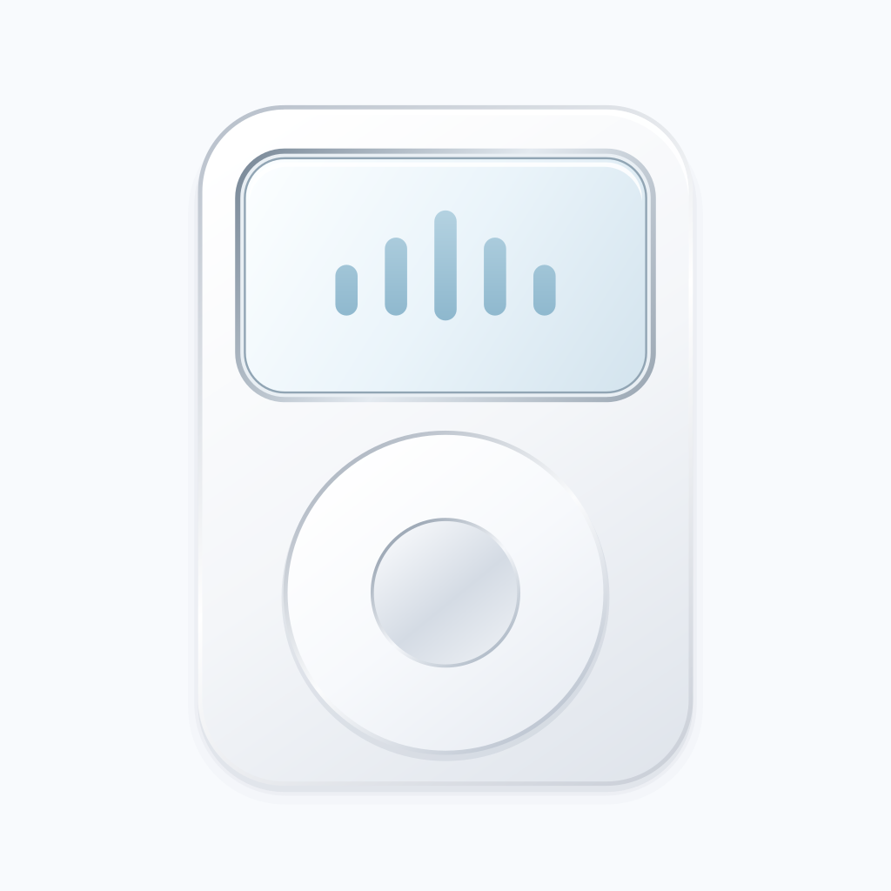

# Pocket Classic 白银图标



依据已确定的白色、银白色设计，将播放器轮廓、磨砂金属、圆形转轮与淡冰蓝声纹实现为安卓原生矢量资源。渐变与几何保持可缩放，图标内容位于自适应图标的中央安全区域。

| 用途 | 资源 |
| --- | --- |
| 设计语言 | [设计理念](Pocket-Classic-Design-Philosophy.md) |
| 仓库预览 | [pocket-classic-icon.svg](pocket-classic-icon.svg) |
| 标准图标 | `android-player/app/src/main/res/drawable/ic_launcher.xml` |
| 自适应前景 | `android-player/app/src/main/res/drawable/ic_launcher_foreground.xml` |
| Android 13 主题图标 | `android-player/app/src/main/res/drawable/ic_launcher_monochrome.xml` |
| 自适应入口 | `android-player/app/src/main/res/mipmap-anydpi-v26/ic_launcher.xml` |
| Android 13 入口 | `android-player/app/src/main/res/mipmap-anydpi-v33/ic_launcher.xml` |

在项目根目录执行以下命令，可从同一份几何定义重新生成所有图标资源与 SVG 预览，无需安装额外依赖：

```sh
node tools/generate-icons.mjs
```

AndroidManifest 同时将普通图标和圆形图标指向自适应资源，背景色为 `#F8FAFD`。在安卓开启“主题图标”时，单色版本会遵循系统壁纸配色。
